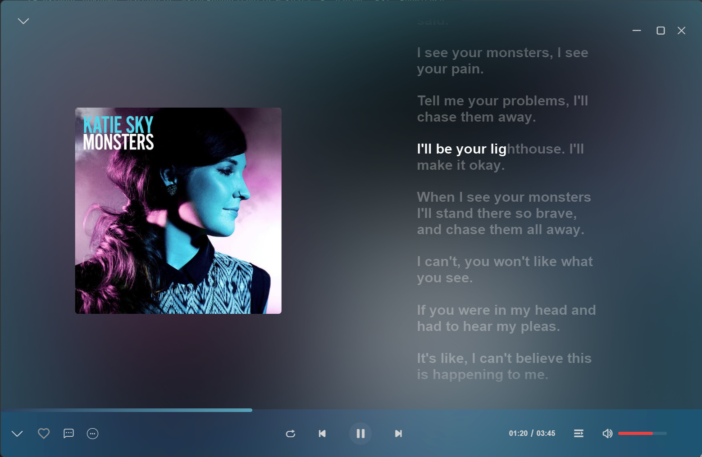
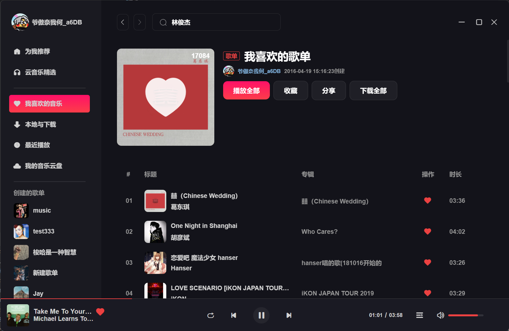
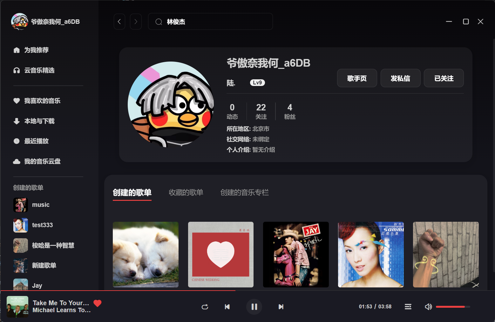
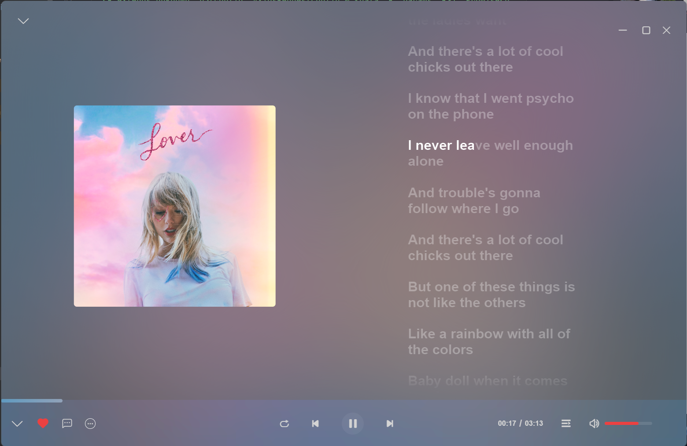
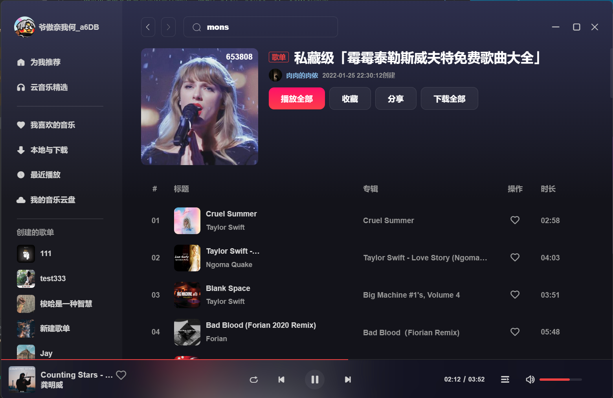

<div align="center">

  <h1>Music</h1>
  <p><strong>音乐、歌词，还有属于你的歌单。</strong></p>
  <p>基于 Vue 3 与 Electron 的音乐桌面应用，支持网易云音乐、逐字歌词和流体背景。</p>

  <p>
    <a href="https://vuejs.org/"></a>
    <a href="https://www.typescriptlang.org/"></a>
    <a href="https://www.electronjs.org/"></a>
    <a href="LICENSE"></a>
  </p>

  <p>
    <a href="#界面预览">界面预览</a> ·
    <a href="#功能一览">功能一览</a> ·
    <a href="#本地运行">本地运行</a> ·
    <a href="#构建与打包">构建与打包</a> ·
    <a href="https://github.com/1727533196/Music/issues">反馈问题</a>
  </p>

</div>

## 界面预览

<p align="center">
  
</p>

<p align="center"><sub>播放详情 · 专辑封面与同步歌词</sub></p>

<details>
<summary>展开更多界面</summary>

<table>
  <tr>
    <td width="50%" align="center">
      
      <br /><sub>我喜欢的音乐</sub>
    </td>
    <td width="50%" align="center">
      
      <br /><sub>个人主页</sub>
    </td>
  </tr>
  <tr>
    <td align="center">
      
      <br /><sub>歌词与背景配色</sub>
    </td>
    <td align="center">
      
      <br /><sub>歌单详情</sub>
    </td>
  </tr>
</table>

</details>

## 功能一览

| 功能       | 说明                                                       |
| ---------- | ---------------------------------------------------------- |
| 音乐发现   | 每日推荐、精选歌单、最近播放与歌曲搜索                     |
| 歌曲播放   | 播放队列、进度控制、音量调节与播放 / 暂停音量过渡          |
| 歌词显示   | 基于 `@lrc-player/core` 的逐字歌词与同步滚动               |
| 动态背景   | 根据封面提取配色，支持流体、渐变等歌词背景                 |
| 歌单管理   | 创建歌单、添加与移除歌曲、管理喜欢的音乐                   |
| 评论浏览   | 从歌曲菜单进入评论，显示评论数量，超过 9999 显示为 `9999+` |
| 我的音乐   | 个人主页、收藏歌单与音乐云盘                               |
| 账号登录   | 二维码登录与手机号验证码登录                               |
| 个性化设置 | 歌词背景、字体与自定义 API 服务器地址                      |

## 本地运行

### 环境准备

- **Node.js**：20 或更高版本，推荐 22 LTS。
- **pnpm**：项目使用 `10.33.2`，与 `package.json` 中的 `packageManager` 保持一致。
- **API 服务**：使用 [NeteaseCloudMusicApi Enhanced](https://github.com/NeteaseCloudMusicApiEnhanced/api-enhanced)，也可连接已部署的兼容服务。

```bash
npm install -g pnpm@10.33.2
```

### 1. 获取项目

将应用与 API 仓库放在同一目录下。后端目录命名为 `NeteaseCloudMusicApi`，方便后续使用内置安装器构建脚本。

```bash
git clone https://github.com/1727533196/Music.git Music
git clone https://github.com/NeteaseCloudMusicApiEnhanced/api-enhanced.git NeteaseCloudMusicApi
```

### 2. 启动 API 服务

在一个终端中运行：

```bash
cd NeteaseCloudMusicApi
npm install
npm start
```

记下启动日志中的服务地址。应用默认连接 `http://127.0.0.1:3000`；如果后端使用其他端口，请在下一步配置为实际地址。

### 3. 配置并启动应用

在另一个终端中进入 `Music` 目录：

```bash
cd Music
pnpm install
pnpm dev
```

`pnpm dev` 会启动 Vite 开发服务和 Electron 窗口。

**修改 API 地址**有两种方式：

- 在应用内打开 **设置 → 网络设置 → API 服务器地址**，输入地址并点击“应用”。
- 在项目根目录创建 `.env.development.local`，配置后重新运行 `pnpm dev`：

```dotenv
VITE_URL=http://127.0.0.1:3000
```

应用内保存的网络设置会优先于环境变量。生产构建的默认地址可通过 `.env.production.local` 中的同名变量配置。

### 4. 登录账号

在应用内打开登录窗口，使用网易云音乐 App 扫码，或通过手机号验证码登录。每日推荐、个人歌单与云盘等账号功能需要登录后使用。

## 构建与打包

### 应用构建

| 命令                | 用途                                                  | 输出目录 |
| ------------------- | ----------------------------------------------------- | -------- |
| `pnpm build`        | 编译主进程、预加载脚本与页面                          | `out/`   |
| `pnpm start`        | 预览已编译的桌面应用，需先运行 `pnpm build`           | —        |
| `pnpm build:unpack` | 生成未封装的应用目录                                  | `dist/`  |
| `pnpm build:win`    | 构建 Windows 应用安装包                               | `dist/`  |
| `pnpm build:mac`    | 构建 macOS 应用，当前配置为 Apple Silicon / arm64 DMG | `dist/`  |
| `pnpm build:linux`  | 按配置构建 AppImage、snap 与 deb 包                   | `dist/`  |

普通应用打包与下方的自定义安装器构建是两条流程：如需随安装器分发本地 API 服务，使用下方命令。

### 带本地 API 服务的安装器

项目提供独立的图形化安装器，支持 **macOS arm64** 与 **Windows x64**。构建前保持以下目录结构：

```text
workspace/
├── Music/
└── NeteaseCloudMusicApi/
```

在 `Music` 目录中，按当前系统选择命令：

```bash
# macOS
pnpm installer:build:mac

# Windows（在 Windows 命令环境执行）
pnpm installer:build:win
```

脚本依次构建 API 服务可执行文件、音乐主应用与安装器，最终产物位于 `dist/installer/`。

## 项目结构

```text
Music/
├── src/
│   ├── main/                 # Electron 主进程、窗口与本地服务管理
│   ├── preload/              # 预加载脚本与进程通信桥接
│   └── renderer/src/
│       ├── api/              # 音乐、歌单、登录等接口
│       ├── components/       # 播放器、歌词、歌曲列表与流体背景
│       ├── layout/           # 侧栏、顶栏等应用布局
│       ├── store/            # 播放状态、账号与设置
│       ├── utils/            # 请求封装与公共逻辑
│       └── views/            # 首页、搜索、歌单、评论等页面
├── installer/                # 独立图形化安装器
├── public/demo-images/       # 项目截图
├── electron.vite.config.ts   # 开发与编译配置
└── electron-builder.yml      # 应用打包配置
```

## 常见问题

<details>
<summary><strong>启动后没有内容，或提示接口请求失败</strong></summary>

先确认 API 服务已启动，再检查应用中的服务器地址是否与后端日志一致。默认地址使用 `3000` 端口；如果你的后端使用 `3006` 等其他端口，需要同步修改。可在浏览器中访问 API 地址，确认服务能够响应。

如果修改环境变量后地址没有变化，请检查应用内是否已保存过自定义网络设置。

</details>

<details>
<summary><strong>Electron 下载不完整，开发窗口无法启动</strong></summary>

先重新运行 `pnpm install`。如果提示 Electron 未正确安装，可在项目根目录重新下载二进制文件：

```bash
node node_modules/electron/install.js
```

下载完成后运行 `pnpm dev`。下载失败时检查网络或 Electron 镜像配置。

</details>

<details>
<summary><strong>构建安装器时提示找不到后端目录或文件</strong></summary>

安装器脚本依赖相邻的 `../NeteaseCloudMusicApi` 目录。请核对目录名称与位置，并使用 `installer:build:mac` 或 `installer:build:win` 完整构建；仅运行 `installer:dev` 不会生成主应用或 API 服务文件。

</details>

## 技术与相关项目

| 层级       | 技术                                    |
| ---------- | --------------------------------------- |
| 桌面运行时 | Electron 31                             |
| 页面与状态 | Vue 3 · TypeScript · Vue Router · Pinia |
| UI 与样式  | Vuetify · Element Plus · Less           |
| 动画与图形 | GSAP · Three.js                         |
| 开发与打包 | Vite · electron-vite · electron-builder |

感谢以下项目提供支持：

- [NeteaseCloudMusicApi Enhanced](https://github.com/NeteaseCloudMusicApiEnhanced/api-enhanced)：网易云音乐 API 服务。
- [@lrc-player/core](https://www.npmjs.com/package/@lrc-player/core)：逐字歌词组件。
- [@lrc-player/parse](https://www.npmjs.com/package/@lrc-player/parse)：歌词解析工具。

## 反馈与贡献

欢迎通过 [Issues](https://github.com/1727533196/Music/issues) 反馈问题或提出建议，也欢迎提交 Pull Request。反馈问题时请附上系统版本、复现步骤，以及相关截图或报错信息。

## 许可证

本项目采用 [MIT License](LICENSE)。
